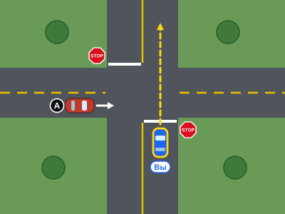
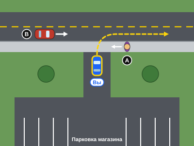

# PDD — два новых ситуационных вопроса по праву проезда (проект, 05.11.2026)

**Статус:** APPROVED пользователем 05.11.2026 (редакция 2: тексты, ключи, объяснения, обе схемы). Встроено как Q636 (N1) и Q637 (N2) — см. `releases/2026-11-05-right-of-way-questions.md`. Текст ниже — утверждённая редакция, не изменялся.

**Основа:** `main` = `679957d37d27fa28c14ea5ec8458ef1e6e249932` (совпадает с `origin/main` на 05.11.2026). Данные банка прочитаны исполнением скрипта приложения с заглушками DOM/localStorage (как в `tests/integrity.cjs`): 636 вопросов, тема «Право проезда и перекрёстки» — 26 ID.

**Нумерация ниже (N1, N2) условная.** Постоянные ID назначаются при интеграции. **Тема для обоих вопросов (решение пользователя 05.11.2026): «Право проезда и перекрёстки».** Наличие схемы не требует отдельной учебной темы.

**Редакция 2 (05.11.2026)** — по замечаниям пользователя: уточнён разбор варианта 1 и объяснение N1 (правило машины справа); в N2 обязанность уступить машинам сформулирована как обязанность до выезда на проезжую часть; ключи в проверке качества указаны раздельно; добавлены PNG-превью каждой схемы. Условия, варианты, ключи и SVG не менялись.

## Проверка на дубли

Просмотрены все 26 вопросов темы (64, 65, 66, 67, 68, 275, 289, 294–307, 422, 434, 439, 634, 635), 21 ситуационный вопрос со схемами (195–215) и поиск по всему банку («тротуар», «двор», «подъезд», «driveway», «второстепенн», «главн», «мигающий красный» и др.).

| Уже есть | Где |
|---|---|
| Четырёхсторонний STOP: кто приехал первым / одновременно справа | 64, 209, 634, 635 |
| Левый поворот против встречного прямо | 65, 199, 299 |
| Перекрёсток без знаков: правило правой руки | 294, 300 |
| Определение знака STOP / YIELD | 304, 305 |
| Выезд задним ходом с подъезда (дети, обзор) | 214, 522 |
| Мотоцикл с поворотником при выезде со второстепенной | 139 |

**Не найдено:** (1) двусторонний STOP — водитель остановился раньше, но машина на дороге без STOP всё равно имеет преимущество; (2) выезд передним ходом с прилегающей территории через тротуар — остановка до тротуара, уступить пешеходу, затем машинам на улице. Оба сценария выбраны как новые. Q64 и Q68 не затрагиваются.

---

## N1 — STOP только на вашей дороге

Файл схемы: `editorial/svg/row-new-1-two-way-stop.svg`; PNG-превью: `editorial/svg/row-new-1-preview.png`.

**Условие:** Вы полностью остановились у знака STOP и хотите проехать перекрёсток прямо. Знаки STOP стоят только на вашей дороге; на пересекающей дороге знаков и светофора нет. Вы остановились раньше, чем машина A подъехала к перекрёстку. Сейчас A приближается слева и уже близко: если вы тронетесь, ей придётся тормозить. Пешеходов нет. Что правильно?

**Варианты (порядок до перемешивания):**

0. Ехать первым: вы остановились у перекрёстка раньше, чем к нему подъехала машина A
1. Ехать первым: машина A приближается слева, а уступать нужно только машине справа
2. Пропустить машину A: у неё нет знака STOP, и она уже слишком близко к перекрёстку
3. Медленно выехать вперёд, чтобы водитель машины A заметил вас и притормозил

**Ключ:** `[2]` (индексы от нуля). Тип `m`; ученик не видит, сколько ответов верны.

**Разбор вариантов:**

- **0 — неверно.** Очерёдность «кто первым остановился, тот первым едет» действует на перекрёстке, где STOP стоят на всех подъездах (four-way stop). Здесь машина A останавливаться не обязана; ваша более ранняя остановка ей преимущества не отменяет. *Заблуждение: перенос правила four-way stop на двусторонний STOP.*
- **1 — неверно.** Учебник отдаёт преимущество машине справа в двух случаях: на перекрёстке без знаков STOP/YIELD и без сигналов и при одновременном прибытии на перекрёсток с четырьмя STOP, где остановиться обязаны все. Здесь другой случай: STOP установлен только для вас, а машина A останавливаться не обязана. По §14-301(c) после остановки вы уступаете такой машине, если она уже на перекрёстке или так близко, что создаёт непосредственную опасность, — независимо от того, едет она слева или справа. *Заблуждение: правило правой руки применяют, когда другая машина останавливаться не обязана.*
- **2 — верно.** Водитель у знака STOP после полной остановки уступает транспорту, который не обязан останавливаться и уже находится на перекрёстке или приближается так близко, что создаёт непосредственную опасность. В условии A именно такая: если тронуться, ей придётся тормозить.
- **3 — неверно.** Медленный выезд перед A — тоже невыполнение обязанности уступить: A пришлось бы реагировать на вас. Учебник: продвигаться вперёд можно только когда это безопасно. *Заблуждение: «покажусь — и меня пропустят».*

**Объяснение для приложения (поле объяснения):**
После полной остановки у знака STOP уступите транспорту, который не обязан останавливаться и уже находится на перекрёстке или так близко, что создаёт опасность, — с какой бы стороны он ни ехал. Очерёдность по времени прибытия и преимущество машины справа при одновременном прибытии относятся к перекрёстку, где STOP стоят на всех подъездах. Здесь машина A останавливаться не обязана, поэтому эти правила не применяются. Conn. Gen. Stat. §14-301(c); учебник Connecticut DMV, Right-of-Way и Stop Sign.

**Источники (проверены 05.11.2026):**

- Conn. Gen. Stat. **§14-301(c)**, Chapter 249, General Statutes revised to January 1, 2026: https://prdext3.cga.ct.gov/current/pub/chap_249.htm#sec_14-301 — водитель останавливается у знака STOP и «shall yield the right-of-way to vehicles not so obliged to stop which are within the intersection or approaching so closely as to constitute an immediate hazard». В 2026 Supplement (https://prdext3.cga.ct.gov/2026/sup/chap_249.htm) §14-301 отсутствует, т. е. в сессиях 2025 г. не изменялся.
- §14-301(d) там же: при STOP на всех углах правила (c) применяются ко всем пересекающимся улицам — это и есть отличие four-way stop.
- Connecticut DMV, *Driver's Manual 2023* (онлайн), раздел **Right-of-Way** — два правила о машине справа: (а) «At an intersection where there is no stop sign, yield sign or oncoming traffic signal, drivers must yield to vehicles coming from the right»; (б) at a four-way stop: «If more than one vehicle arrives at the same time, the vehicle on the right goes first». Ни одно из них не описывает перекрёсток, где остановиться обязан только один из водителей. Раздел **Traffic Signs → Octagon: Stop**: после остановки «yield the right-of-way to any vehicle or pedestrian approaching from either direction»; **Stop Sign**: «You may pull forward only when it is safe to do so». https://portal.ct.gov/dmv/licenses-permits-ids/ct-drivers-manuals/ct-drivers-manual-2023

**Согласованность схемы и условия:**

- «Вы» — синяя машина с жёлтой обводкой, едет вверх, стоит перед белой стоп-линией на своей (правой) половине дороги; знак STOP справа от подъезда.
- Второй знак STOP и стоп-линия — у встречного подъезда вашей дороги. На пересекающей дороге нет ни знаков, ни стоп-линий.
- Машина A — на ближней к вам полосе пересекающей дороги, едет к перекрёстку слева направо (стрелка), почти у его границы.
- Траектория «Вы» — прямо. Пешеходов, переходов и светофора нет. Направления по сторонам света не используются.

---

## N2 — выезд с парковки через тротуар

Файл схемы: `editorial/svg/row-new-2-driveway-sidewalk.svg`; PNG-превью: `editorial/svg/row-new-2-preview.png`.

**Условие:** Вы выезжаете передним ходом с парковки магазина на городскую улицу и хотите повернуть направо. Выезд пересекает тротуар. По тротуару справа идёт пешеход A: сейчас он пройдёт перед вашей машиной. По улице слева, в той полосе, куда вы поворачиваете, приближается машина B, она уже близко. Других машин и пешеходов нет. Что правильно?

**Варианты (порядок до перемешивания):**

0. Остановиться до въезда на тротуар и уступить пешеходу A, который по нему идёт
1. Выехать на улицу только после того, как машина B проедет мимо выезда
2. Не останавливаться: пешеход идёт не по переходу, и уступать ему не нужно
3. Сразу подъехать к краю проезжей части, перекрыв тротуар: так лучше видно машину B

**Ключ:** `[0,1]` (индексы от нуля). Тип `m`; ученик не видит, сколько ответов верны.

**Разбор вариантов:**

- **0 — верно.** Выезжая с прилегающей территории в жилом или деловом районе, водитель обязан остановиться непосредственно перед тротуаром (или участком тротуара, проходящим через выезд) и уступить пешеходу.
- **1 — верно.** Прежде чем выехать на проезжую часть, водитель уступает всем машинам, которые по ней приближаются: выезжать перед ними нельзя. B едет в ту полосу, куда вы поворачиваете, и уже близко, поэтому выезжать можно только после того, как она проедет.
- **2 — неверно.** Обязанность уступить пешеходу на тротуаре через выезд прямо установлена законом и не зависит от разметки перехода. *Заблуждение: пешеходам уступают только на переходах.*
- **3 — неверно.** Остановиться нужно до тротуара, а не на нём; перекрыв тротуар, вы преградите путь пешеходу A. *Заблуждение: ради обзора можно сначала выдвинуться к краю проезжей части.*

**Объяснение для приложения (поле объяснения):**
Выезжая с парковки, двора или из здания в жилом или деловом районе, остановитесь перед тротуаром и уступите пешеходам — переход для этого не нужен. Прежде чем выехать на проезжую часть, уступите всем машинам, которые по ней приближаются: не выезжайте перед ними. Conn. Gen. Stat. §14-247a; учебник Connecticut DMV, Right-of-Way.

**Источники (проверены 05.11.2026):**

- Conn. Gen. Stat. **§14-247a** «Right-of-way yielded by one emerging from alley, driveway or building», Chapter 248, revised to January 1, 2026: https://prdext3.cga.ct.gov/current/pub/chap_248.htm#sec_14-247a — водитель «shall stop such vehicle immediately prior to driving onto a sidewalk or onto the sidewalk area extending across any alleyway or driveway», уступает пешеходу и «upon entering the roadway shall yield the right-of-way to all vehicles approaching on such roadway». В 2026 Supplement (https://prdext3.cga.ct.gov/2026/sup/chap_248.htm) §14-247a и §14-247 отсутствуют.
- Conn. Gen. Stat. **§14-247** «Right-of-way at driveway or private road», та же страница: «The driver of a vehicle about to enter or cross a highway from a private road or driveway shall yield the right-of-way to all vehicles approaching on such highway». Именно «about to enter» — водитель, который ещё только собирается выехать, — обосновывает формулировку «прежде чем выехать… уступите». Формулировка §14-247a «upon entering the roadway» ей не противоречит: уступить при выезде — значит не выезжать перед приближающимися машинами.
- Connecticut DMV, *Driver's Manual 2023* (онлайн), раздел **Right-of-Way**: «Drivers entering a road from a driveway, alley or roadside must yield to vehicles already on the main road.» https://portal.ct.gov/dmv/licenses-permits-ids/ct-drivers-manuals/ct-drivers-manual-2023

**Ограничение:** §14-247a распространяется на «business or residence area». Условие («парковка магазина», «городская улица») это покрывает. В учебнике отдельной фразы об остановке перед тротуаром нет; основание варианта 0 — закон.

**Согласованность схемы и условия:**

- «Вы» — на выездной дорожке с парковки, едет вверх и стоит перед светло-серым тротуаром; тротуар непрерывно проходит через выезд.
- Пешеход A — на тротуаре справа от выезда, стрелка показывает движение к выезду.
- Машина B — на ближней к выезду полосе улицы, едет слева направо (стрелка) — в ту же полосу, куда ведёт жёлтая траектория правого поворота «Вы».
- Других участников нет. Направления по сторонам света не используются.

---

## Проверка качества

- Ключи заданы заранее и следуют из условия и закона: **N1 — `[2]`** (один верный вариант), **N2 — `[0,1]`** (два верных варианта). В каждом вопросе все варианты вне ключа неверны.
- Каждый неверный вариант отражает распространённое заблуждение, не является нелепым.
- Длина вариантов (символов): N1 — 81 / 80 / 81 / 74 (верный 81); N2 — 77 / 68 / 72 / 81 (верные 77 и 68). Верный ответ не выделяется длиной.
- Формулировки не раскрывают число верных ответов. Приложение для типа `m` не выводит количество ключей (подсказки «выберите все верные» удаляются кодом).
- Направления «с севера/юга» не используются; только «слева/справа» с точки зрения водителя, и схема ориентирована так, что «Вы» едет вверх.
- SVG: 400×300, тот же стиль, цвета и обозначения, что в вопросах 195–215. Отрисовка проверена в headless Edge; PNG-превью 800×600: `editorial/svg/row-new-1-preview.png`, `editorial/svg/row-new-2-preview.png`.

## Находка для отдельной проверки (в этой задаче не исправляется)

В схеме существующего вопроса **Q209** (four-way STOP) стоп-линии верхнего и нижнего подъездов нарисованы на половинах дороги для выезда, а не на полосах подъезда: у «Вы» (x=225) линия расположена на x=152–198. Знаки STOP и машины расположены верно; текст и ключ вопроса это не затрагивает. Статус: VERIFIED по данным SVG. Требует отдельного поручения.

## Перед интеграцией (отдельное поручение)

1. Согласовать редакцию 2 формулировок N1 и N2.
2. Тема: «Право проезда и перекрёстки» (решено). Флаги `sc`/`hz` и соответственно попадание в «Опасные ситуации» уточнить при интеграции.
3. Вопросы со схемой (`q[4]`) по текущему коду не входят в экзаменационный пул; изменение пула не предлагается.
4. Новые ID — в конец банка. `tests/integrity.cjs` сейчас ожидает ровно 636 вопросов: ожидаемое число придётся обновить по согласованию. Затем браузерная проверка.
